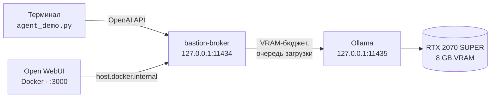

# linuxmintai

**Приватный AI-ассистент системного администрирования.** Всё считается локально: ни один запрос не покидает машину, API-ключей и облачных маршрутов в архитектуре нет.


Ассистент настраивает и обслуживает ОС: диагностика, права, сервисы, память. Код этот ассистент **не пишет** — для программирования осознанно используются внешние облачные модели. Это разделение ролей зафиксировано в [PROMPT.md, шаг 9](PROMPT.md) и не является недоработкой.

---

## Как это работает



Ключевая идея — **bastion-broker** между клиентами и Ollama. На 8 ГБ VRAM помещается ровно одна модель, поэтому все запросы проходят через один сериализованный шлюз: он ведёт учёт VRAM, не даёт двум моделям одновременно претендовать на память и отдаёт телеметрию на `/broker/status`.

## Компоненты

| Компонент | Где живёт | Адрес | Роль |
|---|---|---|---|
| **Ollama** | системный сервис | `127.0.0.1:11435` | движок инференса, flash-attention, KV-кэш q8_0 |
| **bastion-broker** | user-юнит (с linger) | `127.0.0.1:11434` | VRAM-бюджет, очередь, прокси к Ollama |
| **CrewAI-агент** | `~/ai-workspace/venv` | — | агент с инструментом `bash` |
| **Open WebUI** | Docker-контейнер | `127.0.0.1:3000` | чат-интерфейс (опционально) |
| **Мост WebUI → bastion** | `bastion-webui-bridge` | — | route_localnet + DNAT на `docker0` |
| **Панель состояния** | user-юнит `lmintai-status` | `127.0.0.1:11436` | GPU/VRAM/RAM и фаза LLM (опционально) |
| **Desklet** | Cinnamon | — | те же данные на рабочем столе |

Все слушатели — bastion, Ollama и WebUI — привязаны строго к loopback. Проверка после любой настройки:

```bash
ss -tlnp | grep -E ':1143[45]'   # в выводе должны быть только 127.0.0.1
```

## Модели

Одна модель на все роли — `qwen3.5:9b` (Q4_K_M, 9B, thinking, tools). В 8 GB VRAM вторая всё равно не помещается, а каждая смена модели — это выгрузка и загрузка на 5–15 s, поэтому держать отдельную «быструю» модель для агента незачем: она лишь заставляет систему переключаться туда-обратно.

| Модель | Назначение | VRAM (ledger) | Примечание |
|---|---|---|---|
| `qwen3.5:9b` | всё: чат, файлы, агент с инструментами | 5.5 GB | `num_ctx` 24576: файлы до ~24k токенов целиком, **~35 tok/s**; при 16384 было бы 47 tok/s, но промпты >16k режутся вдвое |

`vram_gb` — **замеренный runtime-VRAM** (`size_vram` из `/api/ps`), а не размер файла: размер файла занижает (не учитывает KV-кэш). Завышенное значение запирает модель в очереди по `nvidia-smi backstop`. Установщик тянет модель из реестра Ollama (`ollama pull qwen3.5:9b`).

Серверный дефолт `OLLAMA_CONTEXT_LENGTH=24576` в drop-in Ollama дублирует `default_num_ctx`: агент ходит в OpenAI-совместимый `/v1`, где инъекция `num_ctx` от bastion не применяется, и без этой переменной модель грузится с 4096. Оба значения держите одинаковыми.

`num_ctx` — это компромисс, а не «чем больше, тем лучше»: при 24576 около 684 MB весов уходит в CPU, и скорость падает с 47 до 35 tok/s; зато файл на 53 КБ (21 355 токенов) доходит целиком. При 16384 тот же файл молча режется вдвое. Проверено на этой машине: 47.0 / 35.5 tok/s, `size_vram` 5527 / 5602 MB.

> **Добавляя модель, сразу пропишите её в `~/.config/bastion/broker.yaml`.** Незаявленная модель получает дефолтную оценку 10 GB, которая не влезает в бюджет 7.1 GB, — запрос зависнет на 300 с и вернёт 504. Оценку VRAM можно снять командой `bastion --detect-models`.

## Требования

| Что | Минимум | Зачем |
|---|---|---|
| GPU | NVIDIA, 8 GB VRAM, драйвер ≥ 535 | одна 9B-модель; при `num_ctx` 24576 часть весов уходит в CPU |
| RAM / swap | ОЗУ 16 GB+ (на целевой машине 32 GB), swap ≥ 16 GB | защита от OOM-заморозок (шаг 2.5) |
| Python | 3.10 – 3.13 | требование CrewAI |
| root | sudo или pkexec | установка Ollama, drop-in, мост WebUI |

`uv`, `ollama`, `bastion-broker` и Python-стек ставит сам установщик.

## Быстрый старт

```bash
git clone https://github.com/oblvsp/linuxmintai && cd linuxmintai

./install.sh                # агентный стек: шаги 0–8
./install.sh --with-monitor # + панель состояния и desklet (порт 11436)
./install.sh --with-webui   # то же + Open WebUI в Docker (шаг 10)
./install.sh --with-search  # + SearXNG для веб-поиска агента (порт 8888)
```

Скрипт идемпотентен: настроенные блоки пропускаются, повторный запуск безопасен. В конце он сам проверяет, что слушатели только на loopback, и делает сквозной вызов модели через bastion.

## Использование

### Агент в терминале

```bash
~/ai-workspace/venv/bin/python ~/ai-workspace/agent_demo.py \
  "Покажи, сколько свободной памяти, и предложи одно безопасное действие"
```

Агент работает с `BashTool`. Опасные команды (`rm`, `mv`, `chmod -R`, `dd`, `mkfs`, остановка служб, пакеты, файрвол, `sudo` и т.п.) не блокируются насмерть: инструмент показывает саму команду и причину, а выполнение ждёт ввода `да` в терминале. Без терминала (systemd, скрипт, фон) подтвердить некому — такие команды не выполняются, и агент должен предложить альтернативу. Fork bomb — единственное жёсткое «нет». В конце прогона выводится, какая модель реально была резидентна и сколько VRAM занято.

**Память между запусками** — два текстовых файла в `~/ai-workspace/`:

- `PLAN.md` — то, что агент обязан знать о системе и правилах; правите вы, агент только читает. В промпт уходит не больше 2500 символов.
- `LOG.md` — журнал: после каждого прогона дописывается строка «запрос → итог», в промпт попадают последние 20 строк.

Оба файла подмешиваются к вопросу автоматически ([`examples/project_memory.py`](examples/project_memory.py)): блок занимает ~600 токенов из 24576. Это дешевле встроенной памяти CrewAI, которой для того же нужны эмбеддинги на CPU. Проверка: `agent_demo.py "что ты делал в прошлый раз?"` — отвечает по `LOG.md`, команд не запускает.

### Веб-поиск

Агент умеет искать (`web_search`) и читать страницы (`fetch_page`); оба инструмента ходят только в локальный SearXNG на `127.0.0.1:8888` (`install.sh --with-search`).

**Это единственный канал наружу.** Модель, чат и файлы остаются на машине, но текст поискового запроса и адреса открытых страниц уходят в поисковые системы. Не ищите через агента то, что не отправили бы в открытый поиск.

`fetch_page` не открывает приватные адреса — loopback, LAN, link-local и `169.254.169.254`, включая редиректы; ответ ограничен 1 МБ и 4000 символов текста. Выдержки в результатах бывают устаревшими: инструмент прямо велит агенту открывать первоисточник, но версии и даты всё равно проверяйте (в первом прогоне модель назвала «последнюю стабильную Ollama 0.40.5» при установленной 0.40.11).

Модель одна на всё. Переменные окружения остались для экспериментов — например, если поставите вторую модель и пропишете её в `broker.yaml`:

```bash
LMINTAI_AGENT_MODEL=ollama/<другая-модель> \
  ~/ai-workspace/venv/bin/python ~/ai-workspace/agent_demo.py "вопрос"
```

### Чат в браузере

Откройте <http://127.0.0.1:3000>. При первом входе Open WebUI предлагает создать администратора — сделайте это сразу, контейнер доступен только с этой машины, но аккаунт всё равно ваш.

В **Settings → Model** выставьте `max_tokens` ≥ 2048 (глобальный дефолт 4096 уже задан в `models.default_params`, его выставляет `install.sh --with-webui`). `num_ctx` вручную не трогайте — его подставляет bastion из `default_num_ctx` (24576). С меньшим бюджетом модель тратит его целиком на скрытое рассуждение и возвращает пустой ответ — это и есть причина «непонятного вывода» в прошлых прогонах.

Файлы с кодом прикрепляйте как **`.txt`**, а не `.html`: загрузчик извлекает из HTML только видимый текст и выбрасывает `<script>`/`<style>` (из 53 КБ остаётся ~200 символов), после чего модель уверенно отвечает «кода в файле нет». Для полного текста нужен ещё `rag.full_context = true` (ключ в `webui.db`, `install.sh --with-webui` выставляет его сам), иначе в промпт попадут только `top_k` фрагментов. Файл должен укладываться в `num_ctx`: 53 КБ такого HTML — это 21 355 токенов (≈2.1 символа на токен), то есть при 24576 запас всего ~3k; файлы заметно больше 50 КБ будут молча обрезаны вдвое.

### Напрямую через API

bastion отдаёт OpenAI-совместимый эндпоинт (только без стриминга — на `stream:true` он вернёт буферизованное тело, для чата используйте `/api/*`):

```bash
curl -s http://127.0.0.1:11434/v1/chat/completions \
  -H 'Content-Type: application/json' \
  -d '{"model":"qwen3.5:9b","max_tokens":2048,
       "messages":[{"role":"user","content":"Назови три команды для проверки места на диске"}]}' \
  | jq -r '.choices[0].message.content'
```

### Панель состояния

Откройте <http://127.0.0.1:11436/> — отдельная вкладка рядом с чатом. Панель обновляется раз в секунду и показывает фазу работы LLM, а не только «модель загружена»:

| Фаза | Когда |
|---|---|
| **простой** | запросов нет, модель резидентна |
| **очередь** | запрос ждёт освобождения VRAM (имя модели — из `queue_by_model`) |
| **загрузка модели** | идёт подкачка весов в VRAM |
| **генерация** | модель отвечает |
| **bastion недоступен** | брокер не отвечает, показана подсказка |

Плюс VRAM/GPU/температура, RAM и swap, число запросов и переключений моделей. Данные склеиваются из `/broker/status` и `/proc`, сервис — 150 строк на stdlib без зависимостей (`lmintai-status.service`, loopback).

Там же два API: `/api/status` (JSON) и `/api/text` (4 строки для desklet/Conky).

**Desklet Cinnamon:** установите через `./install.sh --with-monitor`, затем ПКМ по рабочему столу → **Desklets** → «linuxmintai · состояние». Виджет читает `/api/text` каждые 2 секунды (интервал меняется в настройках). После правки `desklet.js` оболочку нужно перезапустить: `cinnamon --replace`.

## Подводные камни

Всё ниже поймано при развёртывании, а не пересказано из документации.

| Симптом | Причина | Решение |
|---|---|---|
| 504 через 300 с, в логе `need 10240MB, available 0MB` | auto-detect VRAM возвращает 0 в systemd user-сервисе; неизвестная модель оценивается в 10 GB | `gpu.total_vram_gb: 8` явно + запись модели в `models:` |
| Очередь стоит 60 с, затем `nvidia-smi backstop: only X GB free, need Y + margin` | бюджет допуска задаёт `hardware_margin_gb` (по умолчанию 2 GB), а `headroom_gb` влияет только на `max_vram_gb`; `vram_gb` взят из размера файла и завышен | `hardware_margin_gb: 0.9` + `vram_gb` по замеру `size_vram` из `/api/ps` |
| Пустой ответ, `done_reason=length` | thinking-модель съела весь бюджет на скрытое рассуждение | `max_tokens` ≥ 2048, `num_predict` ≥ 1024; `thinking:false` не помогает |
| Длинный файл молча теряет хвост | Ollama обрезает промпт только когда он длиннее `num_ctx`, и тогда режет сразу вдвое (`limit = num_ctx − (num_ctx − keep)/2`) | `default_num_ctx: 24576`: файлы до ~24k токенов проходят целиком, ценой 684 MB весов в CPU (35 tok/s вместо 47 при 16384) |
| WebUI «висит» на ответе, в ответе `content-type: application/json` и тело `{"raw":"data: … [DONE]"}` | bastion 0.6.0 буферизует `/v1/*` и не отдаёт SSE на `stream:true` | подключать WebUI нативным Ollama-API (`ENABLE_OLLAMA_API=true` + `OLLAMA_BASE_URL`), OpenAI-провайдер выключить |
| В списке моделей дубли и ошибки соединения | остался включённым OpenAI-провайдер с base URL `.../v1` | Admin → Settings → Connections: очистить base URL и ключи OpenAI |
| Агент работает с контекстом 4096, хотя в `broker.yaml` стоит 24576 | CrewAI/LiteLLM идут в OpenAI-совместимый `/v1`, bastion вставляет `num_ctx` в `options`, а `/v1` их игнорирует | `OLLAMA_CONTEXT_LENGTH=24576` в drop-in Ollama; проверка — `context_length` в `/api/ps` |
| Модель уверяет, что в присланном `.html` нет кода | загрузчик извлекает из HTML только видимый текст: `<script>`/`<style>` отброшены ещё до RAG | прикреплять исходники как `.txt` + `rag.full_context = true` |
| `ollama create` падает без внятной ошибки | сервис работает от `ollama`, а домашний каталог с GGUF — `0750` | импорт через временный `ollama serve` от пользователя + копирование `blobs/` и `manifests-v2/` |
| WebUI: пустой список моделей, затем HTTP 400 | контейнер не видит loopback; bastion отбивает чужой Host | мост `route_localnet`/DNAT + `server.trusted_hosts` |
| Desklet показывает `оÑеÑедÑ` | GJS трактует байты curl как Latin-1 | декодировать UTF-8 вручную (см. `monitor/desklet/desklet.js`) |
| Демо пишет не ту модель, что загружена | поле `current_model` в `/broker/status` устаревает | читать `loaded_models` |

Полные обоснования и команды — в [PROMPT.md](PROMPT.md), по шагам.

## Безопасность

- **Только loopback.** bastion и Ollama слушают `127.0.0.1`; WebUI публикуется как `-p 127.0.0.1:3000:8080`, а не `0.0.0.0`.
- **Никаких секретов.** Облачных API-ключей в системе нет по определению; ключ WebUI к bastion — фиктивная строка.
- **Агент осторожен.** Гейт подтверждения в `BashTool` не ослаблять: чёрный список пропускал 10 из 12 замеренных опасных команд, поэтому решение принимает человек, а не регулярка. Проверка — `examples/bash_tool.py` + тестовый набор в `tests/`.
- **OOM-защита обязательна.** swap ≥ 16 GB, earlyoom `-m 15 -s 60`, `vm.swappiness=10` — реальный инцидент с фризом разобран в PROMPT.md, шаг 2.5.

## Open Interpreter: почему не используется

Установлен (0.0.56), но на 8 ГБ VRAM непригоден: его codex-движок отправляет системный промпт и схемы инструментов на ~11 900 токенов. Контекст такого размера требует KV-кэш, не влезающий в 8 ГБ вместе с весами модели. Агентные задачи закрывает CrewAI-агент с явным набором инструментов. Расчёты и CLI-синтаксис — PROMPT.md, шаг 8.

## Структура репозитория

| Путь | Что это |
|---|---|
| [`install.sh`](install.sh) | идемпотентный установщик, флаги `--with-monitor`, `--with-webui` |
| [`PROMPT.md`](PROMPT.md) | пошаговый промпт развёртывания: команды, обоснования, ловушки |
| [`examples/config_llm.py`](examples/config_llm.py) | LLM-объекты CrewAI + `describe_now()` |
| [`examples/bash_tool.py`](examples/bash_tool.py) | bash-инструмент с гейтом подтверждения |
| [`tests/test_bash_gate.py`](tests/test_bash_gate.py) | проверка гейта: 21 опасная команда, 7 безопасных |
| [`examples/agent_demo.py`](examples/agent_demo.py) | демо-агент |
| [`examples/project_memory.py`](examples/project_memory.py) | PLAN.md + LOG.md в промпт, журнал после прогона |
| [`examples/web_tools.py`](examples/web_tools.py) | `web_search` + `fetch_page` с защитой от SSRF |
| [`tests/test_web_tools.py`](tests/test_web_tools.py) | проверка веб-инструментов и SSRF-защиты |
| [`examples/PLAN.md`](examples/PLAN.md) | шаблон памяти проекта (правится вручную) |
| [`examples/Modelfile`](examples/Modelfile) | шаблон чата для импорта GGUF |
| [`examples/broker.yaml.example`](examples/broker.yaml.example) | эталонный конфиг bastion |
| [`examples/bastion.service`](examples/bastion.service) | user-юнит брокера |
| [`examples/bastion-webui-bridge.service`](examples/bastion-webui-bridge.service) | мост контейнер → loopback |
| [`monitor/status_server.py`](monitor/status_server.py) | панель состояния: JSON + HTML на `:11436` |
| [`monitor/lmintai-status.service`](monitor/lmintai-status.service) | user-юнит панели |
| [`monitor/desklet/`](monitor/desklet/) | desklet Cinnamon (метаданные, JS, стили, настройки) |

## Статус

Стек развёрнут и проверен в бою на целевой машине (Mint 22.3, i5-8400, 32 ГБ RAM, RTX 2070 SUPER 8 ГБ) 2026-10-30: демо-агент выполнял системные команды, модель резидентна на GPU, `bastion --validate` — 0 failed, WebUI и панель состояния отвечают по loopback, desklet показывает живые данные. Известные ограничения: в VRAM помещается одна модель, поэтому стек сведён к `qwen3.5:9b` и переключений нет; при `num_ctx` 24576 около 684 MB весов уходит в CPU — 35 tok/s вместо 47 при 16384, зато файлы до ~24k токенов доходят целиком, а не режутся вдвое.
