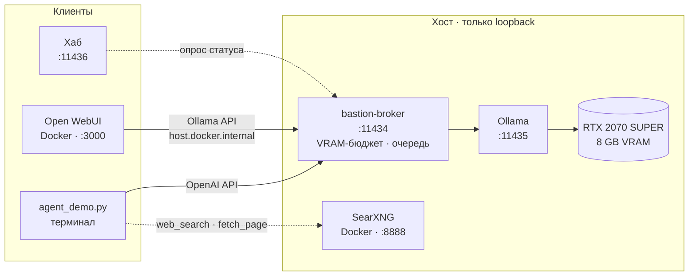
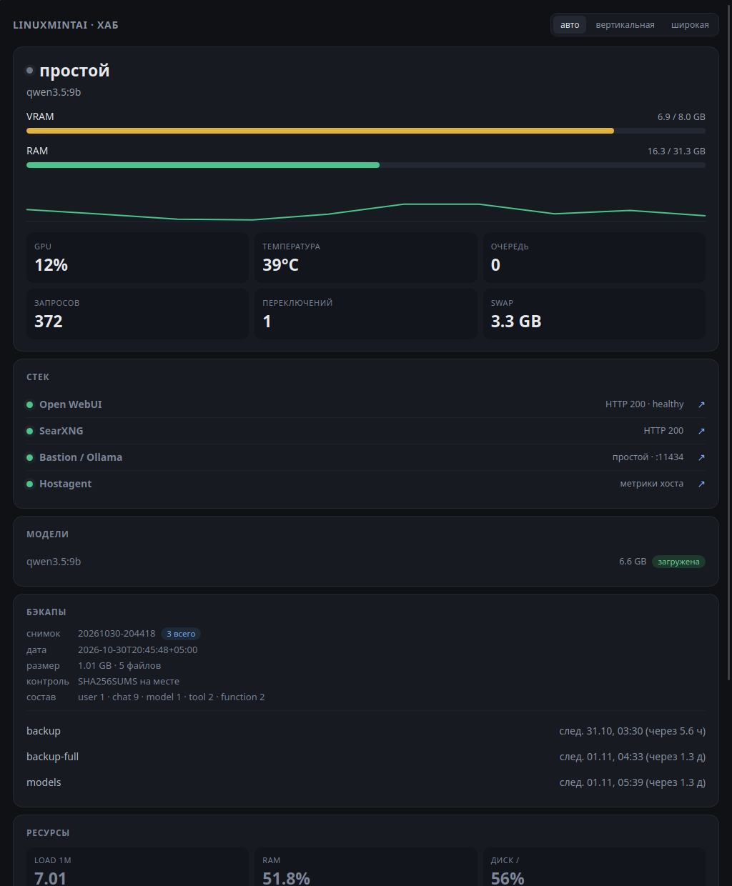
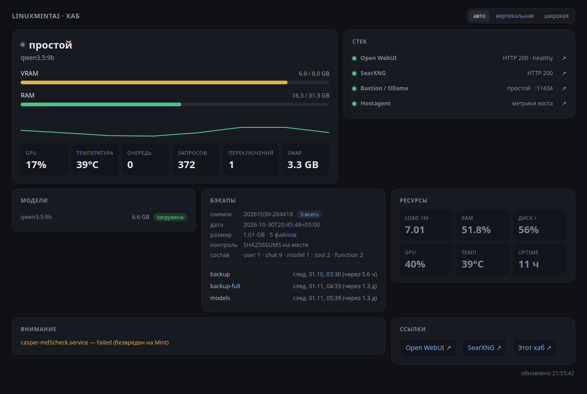

<div align="center">

# linuxmintai

**Локальный AI-ассистент системного администрирования.**
Модель, чат и файлы остаются на этой машине. API-ключей и облачных маршрутов нет. В работе единственный канал наружу — поисковый запрос через локальный SearXNG, и только когда вы сами просите агента что-то найти.

[](https://github.com/oblvsp/linuxmintai#безопасность)
[](https://github.com/oblvsp/linuxmintai#модели-и-контекст)
[](https://github.com/oblvsp/linuxmintai#требования)
[](https://github.com/oblvsp/linuxmintai#требования)
[](https://github.com/oblvsp/linuxmintai#статус)
[](https://github.com/oblvsp/linuxmintai#быстрый-старт)

</div>

> [!IMPORTANT]
> Ассистент настраивает и обслуживает ОС — диагностика, права, сервисы, память, — но **код не пишет**. Для программирования осознанно используются внешние облачные модели: это разделение ролей зафиксировано в [PROMPT.md](PROMPT.md), шаг 9, а не недоработка.

> **Одна модель, один шлюз, ноль облаков.** В 8 ГБ VRAM помещается ровно одна 9B-модель, поэтому вместо оркестрации моделей — сериализованный шлюз с учётом VRAM, очередью и честной телеметрией.

---

## Содержание

- [Архитектура](#архитектура)
- [Компоненты](#компоненты)
- [Быстрый старт](#быстрый-старт)
- [Хаб и мониторинг](#хаб-и-мониторинг)
- [Агент](#агент)
- [Веб-поиск](#веб-поиск)
- [Чат в браузере](#чат-в-браузере)
- [Напрямую через API](#напрямую-через-api)
- [Модели и контекст](#модели-и-контекст)
- [Требования](#требования)
- [Грабли](#грабли)
- [Безопасность](#безопасность)
- [Open Interpreter](#open-interpreter)
- [Структура репозитория](#структура-репозитория)
- [Статус](#статус)

## Архитектура



**bastion-broker** — единственная точка входа к модели. Он ведёт учёт VRAM, не даёт двум моделям одновременно претендовать на память и отдаёт телеметрию на `/broker/status`. Клиенты ходят либо в его OpenAI-совместимый `/v1`, либо в нативный Ollama-API — но всегда через него.

## Компоненты

| Компонент | Где живёт | Адрес | Роль |
|---|---|---|---|
| **Ollama** | systemd-сервис | `127.0.0.1:11435` | инференс, flash-attention, KV-кэш q8_0 |
| **bastion-broker** | user-юнит + linger | `127.0.0.1:11434` | VRAM-бюджет, очередь, прокси к Ollama |
| **CrewAI-агент** | `~/ai-workspace/venv` | — | `bash`, `web_search`, `fetch_page` |
| **Open WebUI** | Docker-контейнер | `127.0.0.1:3000` | чат-интерфейс (опционально) |
| **SearXNG** | Docker-контейнер | `127.0.0.1:8888` | веб-поиск агента (опционально) |
| **Мост WebUI → bastion** | `bastion-webui-bridge` | — | `route_localnet` + DNAT на `docker0` |
| **Хаб + веб-приложение** | user-юнит `lmintai-status` | `127.0.0.1:11436` | стек, модели, бэкапы, ресурсы (опционально) |
| **Desklet** | Cinnamon | — | те же данные на рабочем столе |

Все слушатели — bastion, Ollama, WebUI, SearXNG и хаб — привязаны строго к loopback. Проверка после любой настройки:

```bash
ss -tlnp | grep -E ':1143[456]|:3000|:8888'   # в выводе только 127.0.0.1
```

## Быстрый старт

```bash
git clone https://github.com/oblvsp/linuxmintai && cd linuxmintai

./install.sh                 # агентный стек: шаги 0–8
./install.sh --with-monitor  # + хаб :11436, веб-приложение и desklet
./install.sh --with-webui    # + Open WebUI в Docker :3000
./install.sh --with-search   # + SearXNG :8888 для веб-поиска
```

> [!TIP]
> Флаги комбинируются: `./install.sh --with-monitor --with-webui --with-search`. Скрипт идемпотентен — настроенные блоки пропускаются, повторный запуск безопасен. В конце он сам проверяет loopback-слушатели и делает сквозной вызов модели через bastion.

## Хаб и мониторинг

Read-only панель на `127.0.0.1:11436`: живые метрики раз в секунду, сводка стека раз в 6 секунд. Хаб ничего не меняет — только показывает.

| Вертикальный экран · `/v1` | Широкий экран · `/v2` |
|:---:|:---:|
|  |  |

<sub>Скриншоты с целевой машины: отдельное окно приложения, без браузерной обвязки.</sub>

Две вёрстки под два реальных экрана — портретный 1024×1280 и основной 1920×1080. `/` выбирает режим по ориентации окна и переключает его на лету; фиксированные режимы — `/v1` и `/v2`, переключатель — в шапке.

Что показывает:

- **стек** — WebUI, SearXNG, bastion и hostagent с HTTP-статусом и docker-health;
- **модели** Ollama с отметкой загруженной и занятой VRAM;
- **последний бэкап** — дата, размер, состав, наличие `SHA256SUMS` — и таймеры следующих запусков (каталог снимков задаётся `--backup-dir`);
- **ресурсы** — load, RAM, диск, GPU, температура, uptime;
- **внимание** — сбойные systemd-юниты;
- **ссылки** на интерфейсы.

| Фаза | Когда |
|---|---|
| **простой** | запросов нет, модель резидентна |
| **очередь** | запрос ждёт освобождения VRAM (имя — из `queue_by_model`) |
| **загрузка модели** | идёт подкачка весов в VRAM |
| **генерация** | модель отвечает |
| **bastion недоступен** | брокер не отвечает, показана подсказка |

| Эндпоинт | Что отдаёт |
|---|---|
| `/` | авто-вёрстка по ориентации окна |
| `/v1`, `/v2` | фиксированная вёрстка |
| `/api/status` | живые метрики, JSON |
| `/api/hub` | сводка стека, моделей, бэкапов и сбоев, JSON, кэш 6 с |
| `/api/text` | 4 строки для desklet/Conky |

**Отдельное веб-приложение.** `./install.sh --with-monitor` ставит ярлык «linuxmintai · хаб» в меню → **Программирование**. Окно на GTK3 + WebKit2 открывает хаб без браузерной обвязки: F5 — перезагрузка, F11 — полный экран, при недоступной панели — тёмная заглушка с автоповтором.

**Desklet Cinnamon** читает `/api/text` каждые 2 секунды (интервал меняется в настройках): ПКМ по рабочему столу → **Desklets** → «linuxmintai · состояние». После правки `desklet.js` оболочку нужно перезапустить: `cinnamon --replace`.

Исходники: [`monitor/status_server.py`](monitor/status_server.py) (stdlib, без зависимостей), [`monitor/hub_app.py`](monitor/hub_app.py), [`monitor/lmintai-hub.desktop`](monitor/lmintai-hub.desktop), [`monitor/desklet/`](monitor/desklet/).

## Агент

```bash
~/ai-workspace/venv/bin/python ~/ai-workspace/agent_demo.py \
  "Покажи, сколько свободной памяти, и предложи одно безопасное действие"
```

Три инструмента: `bash`, `web_search`, `fetch_page` (оба ходят только в локальный SearXNG).

**Гейт подтверждения.** Опасные команды — `rm`, `mv`, `chmod -R`, `dd`, `mkfs`, остановка служб, пакеты, файрвол, `sudo` — не блокируются насмерть: инструмент показывает команду и причину, а выполнение ждёт ввода `да`. Без терминала (systemd, скрипт, фон) подтвердить некому — команда не выполняется, агент должен предложить альтернативу. Fork bomb — единственное жёсткое «нет». В конце прогона видно, какая модель была резидентна и сколько VRAM занято.

**Память между запусками** — два текстовых файла в `~/ai-workspace/`:

| Файл | Кто пишет | Что попадает в промпт |
|---|---|---|
| `PLAN.md` | вы; агент только читает | не больше 2500 символов |
| `LOG.md` | агент после каждого прогона | последние 20 строк «запрос → итог» |

Оба подмешиваются автоматически ([`examples/project_memory.py`](examples/project_memory.py)): ~600 токенов из 24576. Проверка: `agent_demo.py "что ты делал в прошлый раз?"` — отвечает по `LOG.md` и не запускает команд.

**Тесты:**

```bash
~/ai-workspace/venv/bin/python tests/test_bash_gate.py
~/ai-workspace/venv/bin/python tests/test_web_tools.py
```

Первый прогоняет классификатор гейта на 21 опасной строке и 7 безопасных; исполняются только фикстуры во временном каталоге. Второй проверяет SSRF-защиту и разбор HTML, а живой поиск — только если поднят `searxng`. Ненулевой код возврата — регрессия.

## Веб-поиск

`web_search` и `fetch_page` ходят только в локальный SearXNG (`install.sh --with-search`).

> [!WARNING]
> Это единственный канал наружу. Модель, чат и файлы остаются на машине, но текст запроса и адреса открытых страниц уходят в поисковые системы. Не ищите через агента то, что не отправили бы в открытый поиск.

`fetch_page` не открывает приватные адреса — loopback, LAN, link-local и `169.254.169.254`, включая редиректы; ответ ограничен 1 МБ и 4000 символов. Выдержки в результатах бывают устаревшими: инструмент велит агенту открывать первоисточник, но версии и даты проверяйте сами (в первом прогоне модель назвала «последнюю стабильную Ollama 0.40.5» при установленной 0.40.11).

Open WebUI может искать через тот же SearXNG: контейнеры состоят в общей сети `llmstack`, поэтому в **Admin Settings → Web Search** выберите SearXNG и укажите `http://searxng:8080/search`. `install.sh` эту настройку не включает автоматически.

## Чат в браузере

Откройте <http://127.0.0.1:3000>. При первом входе Open WebUI предлагает создать администратора — сделайте это сразу: контейнер доступен только с этой машины, но аккаунт всё равно ваш.

| Настройка | Значение | Почему |
|---|---|---|
| `max_tokens` | ≥ 2048 (дефолт 4096) | thinking-модель иначе тратит бюджет на скрытое рассуждение и возвращает пустой ответ |
| `num_ctx` | не трогать | его подставляет bastion из `default_num_ctx` — 24576 |
| вложения | `.txt`, не `.html` | из HTML извлекается только видимый текст: `<script>`/`<style>` отбрасываются (из 53 КБ остаётся ~200 символов) |
| `rag.full_context` | `true` (ставит `install.sh`) | иначе в промпт попадут только `top_k` фрагментов |

Файл должен укладываться в `num_ctx`: 53 КБ такого HTML — это 21 355 токенов (≈2.1 символа на токен), при 24576 запас всего ~3k; файлы заметно больше 50 КБ будут молча обрезаны вдвое.

### Напрямую через API

bastion отдаёт OpenAI-совместимый эндпоинт (без стриминга: на `stream:true` вернётся буферизованное тело — для чата используйте `/api/*`):

```bash
curl -s http://127.0.0.1:11434/v1/chat/completions \
  -H 'Content-Type: application/json' \
  -d '{"model":"qwen3.5:9b","max_tokens":2048,
       "messages":[{"role":"user","content":"Назови три команды для проверки места на диске"}]}' \
  | jq -r '.choices[0].message.content'
```

## Модели и контекст

Одна модель на все роли — `qwen3.5:9b` (Q4_K_M, 9B, thinking, tools). В 8 ГБ VRAM вторая не помещается, а каждая смена модели — это выгрузка и загрузка на 5–15 с.

| Модель | Назначение | VRAM (ledger) | Контекст |
|---|---|---|---|
| `qwen3.5:9b` | чат, файлы, агент с инструментами | 5.5 GB | `num_ctx` 24576 · ~35 tok/s |

`vram_gb` — **замеренный runtime-VRAM** (`size_vram` из `/api/ps`), а не размер файла: файл занижает, потому что не учитывает KV-кэш. Завышенное значение запирает модель в очереди по `nvidia-smi backstop`.

`num_ctx` — компромисс, а не «чем больше, тем лучше»: при 24576 около 684 MB весов уходит в CPU, и скорость падает с 47 до 35 tok/s; зато файл на 53 КБ (21 355 токенов) доходит целиком. При 16384 тот же файл молча режется вдвое. Замерено на целевой машине: 47.0 / 35.5 tok/s, `size_vram` 5527 / 5602 MB.

> [!CAUTION]
> Добавляя модель, сразу пропишите её в `~/.config/bastion/broker.yaml`. Незаявленная модель получает оценку 10 GB, которая не влезает в бюджет 7.1 GB, — запрос зависнет на 300 с и вернёт 504. Оценку VRAM можно снять командой `bastion --detect-models`.

Серверный `OLLAMA_CONTEXT_LENGTH=24576` в drop-in Ollama дублирует `default_num_ctx`: агент ходит в OpenAI-совместимый `/v1`, где инъекция `num_ctx` от bastion не применяется, и без переменной модель грузится с 4096. Оба значения держите одинаковыми.

## Требования

| Что | Минимум | Зачем |
|---|---|---|
| GPU | NVIDIA, 8 GB VRAM, драйвер ≥ 535 | одна 9B-модель; при `num_ctx` 24576 часть весов уходит в CPU |
| RAM / swap | ОЗУ 16 GB+ (на целевой машине 32 GB), swap ≥ 16 GB | защита от OOM-заморозок (PROMPT.md, шаг 2.5) |
| Python | 3.10 – 3.13 | требование CrewAI |
| root | sudo или pkexec | установка Ollama, drop-in, мост WebUI |
| Docker | опционально | Open WebUI и SearXNG |

`uv`, `ollama`, `bastion-broker` и Python-стек ставит сам установщик.

## Грабли

<details>
<summary><b>12 граблей, пойманных при развёртывании, а не пересказанных из документации</b> — развернуть</summary>

<br>

| Симптом | Причина | Решение |
|---|---|---|
| 504 через 300 с, в логе `need 10240MB, available 0MB` | auto-detect VRAM возвращает 0 в systemd user-сервисе; неизвестная модель оценивается в 10 GB | `gpu.total_vram_gb: 8` явно + запись модели в `models:` |
| Очередь стоит 60 с, затем `nvidia-smi backstop: only X GB free, need Y + margin` | бюджет допуска задаёт `hardware_margin_gb` (2 GB по умолчанию), а `headroom_gb` влияет только на `max_vram_gb`; `vram_gb` взят из размера файла | `hardware_margin_gb: 0.9` + `vram_gb` по замеру `size_vram` |
| Пустой ответ, `done_reason=length` | thinking-модель съела бюджет на скрытое рассуждение | `max_tokens` ≥ 2048, `num_predict` ≥ 1024; `thinking:false` не помогает |
| Длинный файл молча теряет хвост | Ollama обрезает промпт, только когда он длиннее `num_ctx`, и сразу вдвое | `default_num_ctx: 24576`: файлы до ~24k токенов проходят целиком |
| WebUI «висит», в ответе `content-type: application/json` и тело `{"raw":"data: … [DONE]"}` | bastion 0.6.0 буферизует `/v1/*` и не отдаёт SSE | подключать WebUI нативным Ollama-API, OpenAI-провайдер выключить |
| Дубли моделей и ошибки соединения | остался включённым OpenAI-провайдер с base URL `.../v1` | Admin → Settings → Connections: очистить base URL и ключи |
| Контекст 4096 при `num_ctx: 24576` | CrewAI/LiteLLM идут в `/v1`, а bastion вставляет `num_ctx` только в `options` Ollama | `OLLAMA_CONTEXT_LENGTH=24576` в drop-in; проверка — `context_length` в `/api/ps` |
| Модель уверяет, что в `.html` нет кода | загрузчик извлекает только видимый текст, `<script>`/`<style>` отброшены до RAG | прикреплять исходники как `.txt` + `rag.full_context = true` |
| `ollama create` падает без внятной ошибки | сервис работает от `ollama`, а каталог с GGUF — `0750` | импорт через временный `ollama serve` от пользователя + копирование `blobs/` и `manifests-v2/` |
| WebUI: пустой список моделей, затем HTTP 400 | контейнер не видит loopback; bastion отбивает чужой Host | мост `route_localnet`/DNAT + `server.trusted_hosts` |
| Desklet показывает `оÑеÑедÑ` | GJS трактует байты curl как Latin-1 | ручной UTF-8 декодер в `monitor/desklet/desklet.js` |
| Демо пишет не ту модель, что загружена | поле `current_model` в `/broker/status` устаревает | читать `loaded_models` |

</details>

Полные обоснования и команды — в [PROMPT.md](PROMPT.md), по шагам.

## Безопасность

- **Только loopback.** bastion, Ollama, SearXNG и хаб слушают `127.0.0.1`; WebUI публикуется как `-p 127.0.0.1:3000:8080`, а не `0.0.0.0`.
- **Веб-поиск под контролем.** `fetch_page` не ходит в приватные адреса даже через редиректы и ограничивает ответ 1 МБ и 4000 символов. Наружу уходит только текст запроса и адрес страницы, и только по явной просьбе.
- **Никаких секретов.** Облачных API-ключей в системе нет по определению; WebUI не требует реального ключа для доступа к bastion.
- **Решение принимает человек.** Чёрный список пропускал 10 из 12 замеренных опасных команд, поэтому гейт показывает команду и ждёт подтверждения. Ослаблять его нельзя; проверка — `examples/bash_tool.py` и `tests/`.
- **OOM-защита обязательна.** swap ≥ 16 GB, earlyoom `-m 15 -s 60`, `vm.swappiness=10` — реальный инцидент с фризом разобран в PROMPT.md, шаг 2.5.

## Open Interpreter

Установлен (0.0.56), но на 8 ГБ VRAM непригоден: codex-движок отправляет системный промпт и схемы инструментов на ~11 900 токенов. Такой KV-кэш не влезает в 8 ГБ вместе с весами. Агентные задачи закрывает CrewAI-агент с явным набором инструментов; расчёты — PROMPT.md, шаг 8.

## Структура репозитория

| Путь | Что это |
|---|---|
| [`install.sh`](install.sh) | идемпотентный установщик, флаги `--with-monitor`, `--with-webui`, `--with-search` |
| [`PROMPT.md`](PROMPT.md) | пошаговый промпт развёртывания: команды, обоснования, ловушки |
| [`examples/agent_demo.py`](examples/agent_demo.py) | демо-агент |
| [`examples/config_llm.py`](examples/config_llm.py) | LLM-объекты CrewAI + `describe_now()` |
| [`examples/bash_tool.py`](examples/bash_tool.py) | bash-инструмент с гейтом подтверждения |
| [`examples/project_memory.py`](examples/project_memory.py) | PLAN.md + LOG.md в промпт, журнал после прогона |
| [`examples/web_tools.py`](examples/web_tools.py) | `web_search` + `fetch_page` с защитой от SSRF |
| [`examples/PLAN.md`](examples/PLAN.md) | шаблон памяти проекта |
| [`examples/broker.yaml.example`](examples/broker.yaml.example) | эталонный конфиг bastion |
| [`examples/bastion.service`](examples/bastion.service) | user-юнит брокера |
| [`examples/bastion-webui-bridge.service`](examples/bastion-webui-bridge.service) | мост контейнер → loopback |
| [`examples/Modelfile`](examples/Modelfile) | шаблон чата для импорта GGUF |
| [`monitor/status_server.py`](monitor/status_server.py) | хаб: HTML, JSON и текст на `:11436`, stdlib |
| [`monitor/hub_app.py`](monitor/hub_app.py) | отдельное окно GTK3 + WebKit2 |
| [`monitor/lmintai-hub.desktop`](monitor/lmintai-hub.desktop), [`monitor/lmintai-hub.svg`](monitor/lmintai-hub.svg) | ярлык и иконка в меню |
| [`monitor/lmintai-status.service`](monitor/lmintai-status.service) | user-юнит хаба |
| [`monitor/desklet/`](monitor/desklet/) | desklet Cinnamon |
| [`tests/test_bash_gate.py`](tests/test_bash_gate.py) | гейт: 21 опасная команда, 7 безопасных |
| [`tests/test_web_tools.py`](tests/test_web_tools.py) | веб-инструменты и SSRF-защита |
| [`docs/screenshots/`](docs/screenshots/) | скриншоты хаба для README |

## Статус

Развёрнуто и проверено в бою 2026-10-30 на Mint 22.3 · i5-8400 · 32 ГБ RAM · RTX 2070 SUPER 8 ГБ:

- демо-агент выполнял системные команды, модель резидентна на GPU, `bastion --validate` — 0 failed;
- WebUI, хаб и desklet отвечают по loopback и показывают живые данные;
- веб-поиск и чтение страниц работают через SearXNG;
- тесты гейта и SSRF-защиты проходят без регрессий;
- хаб проверен в реальных окнах на обоих экранах — портретном 1024×1280 и основном 1920×1080.

**Ограничения.** В VRAM помещается одна модель, поэтому стек сведён к `qwen3.5:9b` и параллельной работы моделей нет. При `num_ctx` 24576 около 684 MB весов уходит в CPU — 35 tok/s вместо 47 при 16384, зато файлы до ~24k токенов доходят целиком, а не режутся вдвое.

---

<sub>Linux Mint 22.3 · i5-8400 · 32 GB RAM · RTX 2070 SUPER 8 GB · Python 3.12 · Ollama 0.40</sub>
